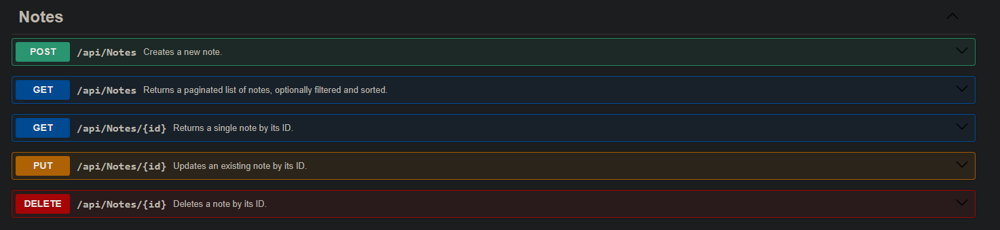

# Notes Backend

[](https://github.com/rluetken-dev/notes-backend/actions/workflows/ci.yml)


[](https://github.com/rluetken-dev/notes-backend/releases)

Clean REST API for managing notes.

The project is built with ASP.NET Core, Entity Framework Core, and SQLite. It provides basic CRUD operations, pagination, filtering, sorting, Swagger documentation, and automated build and test checks.

Optional frontend:

[notes-frontend](https://github.com/rluetken-dev/notes-frontend)

## Features

- CRUD endpoints for notes
- Pagination for note lists
- Text filtering through `q`
- Sorting through `sort` and `dir`
- SQLite persistence with Entity Framework Core
- Swagger/OpenAPI documentation
- XML comments for API documentation
- GitHub Actions CI
- Conventional commit guidelines

## Tech Stack

- .NET 8
- ASP.NET Core Web API
- Entity Framework Core
- SQLite
- Swagger/OpenAPI
- xUnit
- ASP.NET Core integration testing
- GitHub Actions

## Getting Started

### Prerequisites

- [.NET 8 SDK](https://dotnet.microsoft.com/download)
- Optional: [SQLite CLI](https://www.sqlite.org/download.html)

### Run Locally

```powershell
git clone https://github.com/rluetken-dev/notes-backend.git
cd notes-backend

dotnet restore
dotnet ef database update --project Notes.Api
dotnet run --project Notes.Api
```

If the EF Core CLI is not installed yet:

```powershell
dotnet tool install --global dotnet-ef
```

Default local URLs:

```text
http://localhost:5257/swagger
http://localhost:5257/api/notes
```

## Configuration

| Setting | Environment Variable | Default | Description |
| --- | --- | --- | --- |
| Connection string | `ConnectionStrings__Default` | `Data Source=notes.db` | SQLite database file |
| ASP.NET URLs | `ASPNETCORE_URLS` | `http://localhost:5257` | Local host/port binding |

## API Overview

### Create Note

```http
POST /api/notes
```

```json
{
  "title": "Shopping",
  "content": "Milk, Bread, Eggs"
}
```

### Get Notes

```http
GET /api/notes?q=shopping&page=1&pageSize=5&sort=title&dir=asc
```

Supported query parameters:

- `q`: optional text filter
- `page`: page index, default `1`
- `pageSize`: items per page, default `10`
- `sort`: `id`, `title`, `created`, or `updated`
- `dir`: `asc` or `desc`

The response includes `X-Total-Count` with the total number of matching notes.

### Get Note By ID

```http
GET /api/notes/{id}
```

### Update Note

```http
PUT /api/notes/{id}
```

```json
{
  "title": "Updated shopping list",
  "content": "Milk, Bread, Eggs, Butter"
}
```

### Delete Note

```http
DELETE /api/notes/{id}
```

## Endpoints

| Method | Route | Description |
| --- | --- | --- |
| `GET` | `/api/notes` | List notes |
| `GET` | `/api/notes/{id}` | Get note by ID |
| `POST` | `/api/notes` | Create note |
| `PUT` | `/api/notes/{id}` | Update note |
| `DELETE` | `/api/notes/{id}` | Delete note |

## Screenshots

Swagger UI:



## Project Structure

```text
notes-backend/
├─ Notes.Api/
├─ Notes.Api.Tests/
├─ docs/
├─ COMMITS.md
└─ README.md
```

## Tests And Checks

```powershell
dotnet build .\Notes.Api\Notes.Api.sln -c Release
dotnet test .\Notes.Api\Notes.Api.sln -c Release
dotnet format .\Notes.Api\Notes.Api.sln --verify-no-changes
```

## Commits And Releases

This repository follows Conventional Commits and semantic versioning.

- See [COMMITS.md](./COMMITS.md) for commit message guidelines.
- Releases use tags in the format `vX.Y.Z`.
- Release notes should summarize user-visible changes, documentation updates, and validation results.

## Related

- [notes-frontend](https://github.com/rluetken-dev/notes-frontend)
- [notes-backend](https://github.com/rluetken-dev/notes-backend)

## License

MIT
